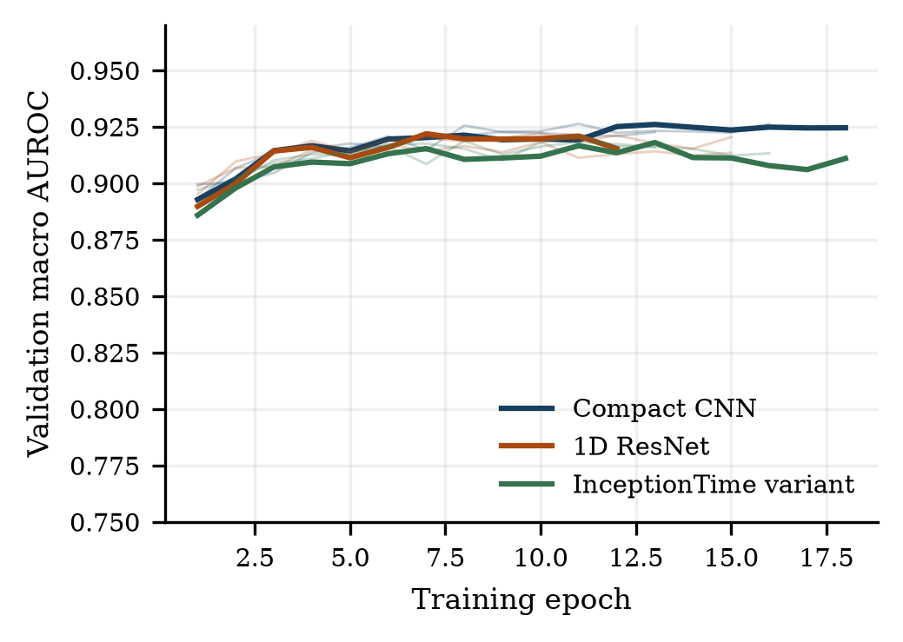
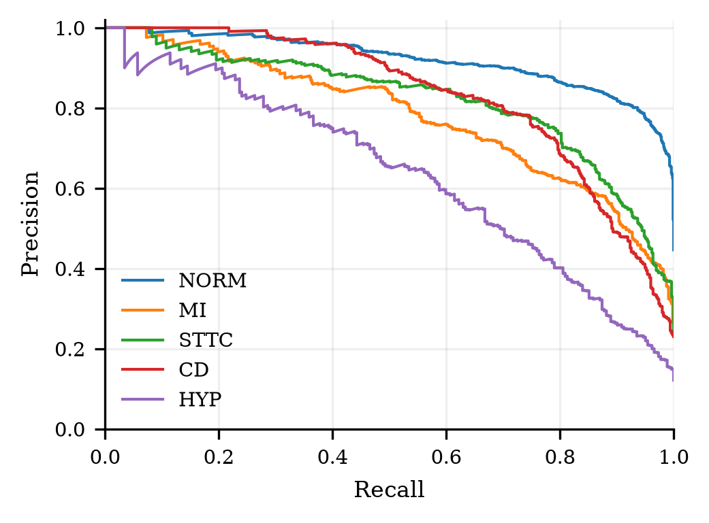

# Explainable ECG classification

We compare lightweight models that predict five diagnostic labels from a 12-lead ECG.
One ECG can contain several labels, so this is a multi-label classification problem.
The project uses PTB-XL version 1.0.3 and its official patient-separated folds.

**Authors:** Tanvi Bandebuche and Maheen Meshram  
**Department:** Computer Science and Engineering  
**Institute:** Symbiosis Institute Of Technology, Nagpur, India

## Start with the notebook

Open [Healthcare_ECG_Colab.ipynb](Healthcare_ECG_Colab.ipynb).
It explains the data, models, training protocol, results, and limitations in order.

The notebook has three paths:

| Path | What it does | Raw dataset needed |
|---|---|---|
| Default cells | Check saved files, recalculate scores, and draw result plots | No |
| Optional ECG example | Run ECG 162 through the saved model and compare its scores | One ECG and release metadata |
| Optional fresh experiment | Download data, train all models, evaluate, and create figures | Yes |

The default path keeps the saved experiment unchanged.
The notebook includes outputs from the local check, so GitHub also shows the tables and plots.

### Google Colab

1. Select **Open in Colab** above.
2. Connect to a runtime.
3. Select **Runtime → Run all**.

The first cell downloads this repository.
The next cell installs missing libraries only.
The default path works without the full waveform dataset.

For the waveform example, set the notebook variable RUN_ECG_EXAMPLE to True.
For a full new experiment, set RUN_FRESH_EXPERIMENT to True.
The notebook keeps both options off by default.

### Jupyter on Windows

Use Python 3.12.
Run these commands in PowerShell:

~~~powershell
git clone https://github.com/Tanvib24/explainable-ecg-classification.git
cd explainable-ecg-classification
py -3.12 -m venv .venv
.venv\Scripts\python.exe -m pip install -r requirements-notebook.txt
.venv\Scripts\python.exe -m notebook Healthcare_ECG_Colab.ipynb
~~~

### Jupyter on Linux or macOS

Use Python 3.12.
Run these commands:

~~~bash
git clone https://github.com/Tanvib24/explainable-ecg-classification.git
cd explainable-ecg-classification
python3.12 -m venv .venv
.venv/bin/python -m pip install -r requirements-notebook.txt
.venv/bin/python -m notebook Healthcare_ECG_Colab.ipynb
~~~

## Project files

~~~text
explainable-ecg-classification/
├── Healthcare_ECG_Colab.ipynb       # Start here
├── README.md
├── requirements-notebook.txt       # Compatible notebook environment
├── requirements-lock.txt           # Original experiment versions
├── DATASET_LICENSE.txt
├── configs/
│   └── protocol.json                # Fixed experiment configuration
├── ecg_project/
│   ├── data.py                      # Download, labels, partitions, normalization
│   ├── models.py                    # Compact CNN, ResNet, InceptionTime variant
│   └── experiment.py                # Training and test evaluation
├── scripts/
│   ├── analyze_results.py           # Plots and occlusion analysis
│   └── verify_evidence.py           # Full check with the prepared dataset
├── tests/
│   └── test_integrity.py
├── results/                         # Checkpoints, predictions, metrics, figures
├── report/
│   └── Healthcare_ECG_IEEE_Report.docx
└── presentation/
    └── Healthcare_ECG_CA3_Presentation.pptx
~~~

The files in ecg_project work together.
The main training entry point is ecg_project/experiment.py.
Running that file alone without the package and configuration is insufficient.

The repository excludes the virtual environment, raw waveforms, temporary builds, and optimizer resume files.
The twelve selected model checkpoints remain available in results/runs.

## Dataset and labels

[PTB-XL version 1.0.3](https://physionet.org/content/ptb-xl/1.0.3/) contains 21,799 ten-second ECGs.
We use the 100 Hz waveforms, with 12 leads and 1,000 samples per lead.
The cohort excludes 411 records without a mapped diagnostic category.
The final cohort contains 21,388 recordings.

| Label | Meaning |
|---|---|
| NORM | Normal ECG |
| MI | Myocardial infarction |
| STTC | ST/T change |
| CD | Conduction disturbance |
| HYP | Hypertrophy |

| Partition | Official folds | Recordings | Patients |
|---|---|---:|---:|
| Training | 1–8 | 17,084 | 14,823 |
| Validation | 9 | 2,146 | 1,917 |
| Test | 10 | 2,158 | 1,877 |

The original checks found no patient overlap or exact waveform duplicates between partitions.
Normalization values and class weights use training data only.
Validation data select the checkpoints and thresholds.
The experiment freezes these selections before test evaluation.

The downloader uses the public S3 mirror that PhysioNet documents.
It checks each waveform against the release SHA-256 manifest.
The dataset uses CC BY 4.0. DATASET_LICENSE.txt contains the dataset license.

## Models and training

| Model | Configuration | Parameters |
|---|---|---:|
| Compact CNN | Three convolution blocks, global pooling, dense head | 221,573 |
| 1D ResNet | Eight residual blocks across four stages | 244,005 |
| InceptionTime variant | Six inception modules with a strided depthwise stem | 115,729 |

The compact CNN uses 64, 128, and 192 channels.
Its kernels have sizes 15, 9, and 5, with stride 2 in each block.
The dense head has 64 units and five output logits.
Independent sigmoid scores allow overlapping labels.

The residual and inception configurations compare architecture families.
They do not reproduce published checkpoints.
The logistic baseline uses 96 waveform summary features and validation-selected regularization.

| Training choice | Value |
|---|---|
| Optimizer | AdamW |
| Learning rate | 0.001 |
| Weight decay | 0.0001 |
| Batch size | 64 |
| Dropout | 0.2 |
| Maximum epochs | 25 |
| Early stopping patience | 5 epochs |
| Checkpoint criterion | Highest validation macro AUROC |
| Seeds | 42, 123, 2026 |
| Threshold selection | Validation F1, grid 0.05–0.95 in steps of 0.01 |

Three seeds cover each model and the unweighted compact CNN, for twelve neural runs.
The unweighted comparison keeps the architecture and training configuration unchanged.

## Measured results

These are measurements from the held-out test fold.
Neural values are means across three seeds.
The logistic baseline uses one fitted model.

| Model | Macro AUROC | Macro average precision | Macro F1 |
|---|---:|---:|---:|
| Compact CNN, weighted | 0.9195 | 0.8018 | 0.7369 |
| 1D ResNet | 0.9140 | 0.7935 | 0.7217 |
| InceptionTime variant | 0.9142 | 0.7949 | 0.7259 |
| Compact CNN, unweighted | 0.9198 | 0.8070 | 0.7398 |
| Logistic features | 0.8173 | 0.6134 | 0.5998 |

The weighted CNN has an AUROC sample standard deviation of 0.0016 across seeds.
Its selected seed-42 checkpoint has AUROC 0.9178.
The 95% patient-bootstrap interval is 0.9099–0.9253.
The bootstrap uses 1,000 patient resamples.

Class weighting did not improve the average scores here.
The differences between neural models do not establish statistical superiority.
HYP has lower recall than NORM, so the category results also matter.

The weighted compact CNN has a mean median forward latency of 0.639 ms on the recorded CPU.
The timing uses one ECG per batch, four CPU threads, 50 warm-up calls, and 500 timed calls per checkpoint.
It excludes disk access, normalization, and explanation generation.

## Check the evidence

The notebook checks file hashes and recalculates metrics from saved predictions.
These checks detect changes and arithmetic errors.
They do not independently establish clinical validity.

| File | Contents |
|---|---|
| results/data-audit.json | Cohort, exclusions, partitions, and duplicate checks |
| results/training-manifest.json | Original environment, configuration, and source hashes |
| results/frozen-selection.json | Selected checkpoints and thresholds before test access |
| results/test-access-log.json | First test inference time and selection hash |
| results/runs/*/history.csv | Loss and validation scores for each epoch |
| results/runs/*/best.pt | Selected model checkpoints |
| results/runs/*/test-predictions.npz | Labels, scores, thresholds, and identifiers |
| results/all-runs.csv | Measurements for all neural runs |
| results/aggregate-results.json | Means and sample standard deviations |
| results/evidence-verification.json | Original full evidence check |
| results/normalization.npz | Frozen training statistics and class weights |

The original full check also compares labels and identifiers with the prepared dataset.
After a fresh experiment, run that check from its project folder:

~~~bash
python scripts/verify_evidence.py
~~~

## Repeat the full experiment

Use the optional fresh-experiment section in the notebook.
It creates .work/fresh-experiment and leaves the report evidence unchanged.
It runs these commands in the new folder:

~~~bash
python -m unittest discover -s tests -v
python -m ecg_project.data fetch --workers 8
python -m ecg_project.data prepare
python -m ecg_project.experiment train
python -m ecg_project.experiment evaluate
python scripts/verify_evidence.py
python scripts/analyze_results.py
~~~

The original run used Windows, Python 3.12.14, PyTorch 2.14.1+cpu, and an Intel Core Ultra 5 245K.
The machine had 32 GB RAM.
The configuration uses four CPU threads per process and up to three training processes.
All neural runs stopped after 12–18 epochs.

The full experiment needs substantial memory, disk space, and time.
Free Colab sessions can stop before completion.
The protocol uses the CPU even when Colab provides a GPU.
New environments can produce different scores and timings.

For the recorded package versions, use a separate Python 3.12 environment:

~~~bash
python -m pip install torch==2.14.1+cpu --index-url https://download.pytorch.org/whl/cpu
python -m pip install -r requirements-lock.txt
~~~

The lock file records the original dependencies.
Installing these versions alone does not reproduce the original hardware or operating system.

## Report and presentation

- [Six-page IEEE report](report/Healthcare_ECG_IEEE_Report.docx)
- [14-slide PowerPoint](presentation/Healthcare_ECG_CA3_Presentation.pptx)

The report includes the methodology, equations, hyperparameters, comparisons, results, and complete reference list.
The PowerPoint includes source notes and an editable latency chart.
Institutional AI and similarity reports are separate submission documents.

## Limitations

This study uses one historical dataset and an internal test fold.
It has no external hospital test, prospective study, probability calibration, or subgroup fairness assessment.
Occlusion measures model sensitivity, rather than physiological causality.
No clinician reviewed the explanations.
The results do not establish clinical safety or treatment benefit.

## References

Wagner et al. PTB-XL, a large publicly available electrocardiography dataset. Scientific Data, 2020.
[DOI](https://doi.org/10.1038/s41597-020-0495-6).

Wagner et al. PTB-XL version 1.0.3. PhysioNet, 2022.
[DOI](https://doi.org/10.13026/kfzx-aw45).

Strodthoff et al. Deep learning for ECG analysis: Benchmarks and insights from PTB-XL. IEEE JBHI, 2021.
[DOI](https://doi.org/10.1109/JBHI.2020.3022989).

Strodthoff et al. PTB-XL+, a comprehensive electrocardiographic feature dataset. Scientific Data, 2023.
[DOI](https://doi.org/10.1038/s41597-023-02153-8).

The report contains 18 references, including 15 research papers from 2022 onward.
